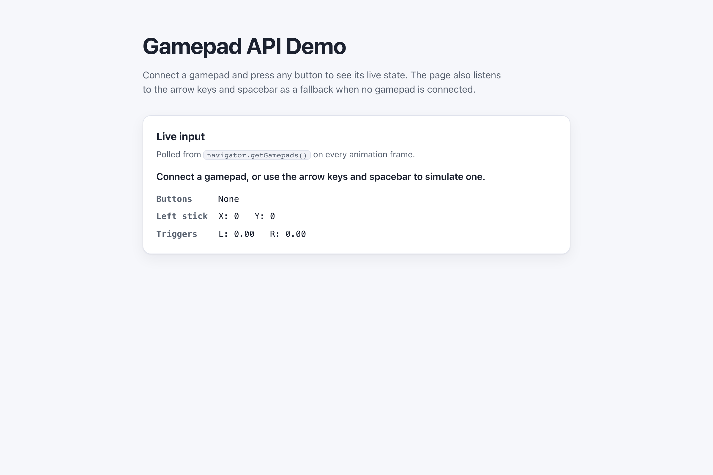

# WebSharper.Gamepad

[](https://github.com/dotnet-websharper/GamepadAPI)

WebSharper bindings for the [Gamepad API](https://developer.mozilla.org/en-US/docs/Web/API/Gamepad_API) —
detecting and reading game controllers from F# and C# web apps.

This repository contains:

| Project | Purpose |
| --- | --- |
| `WebSharper.Gamepad` | The binding: WIG definitions for `Gamepad`, `GamepadButton`, `GamepadHapticActuator`, `GamepadPose`, `GamepadEvent`, and their option dictionaries. |
| `WebSharper.Gamepad.Extensions` | `[<Inline>]` client extensions: `Navigator.GetGamepads()` and the `Window.OnGamepadConnected` / `OnGamepadDisconnected` handlers. |
| `WebSharper.Gamepad.Sample` | An ASP.NET Core SPA that shows the live state of a connected gamepad. |

## Live demos

**Try it live:** [Open the sample in your browser](https://dotnet-websharper.github.io/GamepadAPI/)



The sample doubles as the binding's test case: it polls the gamepad state on every animation frame and reacts to
`gamepadconnected` / `gamepaddisconnected` events.

- **Sample (this repository):** <https://dotnet-websharper.github.io/GamepadAPI/>
- **Source repository:** <https://github.com/dotnet-websharper/GamepadAPI>
- **WebSharper bindings:** <https://websharper.com/bindings>

## Features

- `Gamepad` (`id`, `index`, `mapping`, `connected`, `timestamp`, `axes`, `buttons`, `hand`, `pose`, `hapticActuators`, `vibrationActuator`).
- `GamepadButton` (`pressed`, `touched`, `value`).
- `GamepadHapticActuator` (`effects`, `playEffect`, `pulse`, `reset`) and `GamepadHapticEffectParams`.
- `GamepadPose` (`hasOrientation`, `hasPosition`, `position`, `orientation`, `linearVelocity`, `angularVelocity`, and the accelerations).
- `GamepadEvent` / `GamepadEventInit`.
- `Navigator.getGamepads()` and the `gamepadconnected` / `gamepaddisconnected` events in the Extensions assembly.

## Installation

The binding is not currently published to NuGet. Reference the projects from source:

```bash
git clone https://github.com/dotnet-websharper/GamepadAPI.git
```

```xml
<ItemGroup>
  <ProjectReference Include="path/to/WebSharper.Gamepad/WebSharper.Gamepad.fsproj" />
  <ProjectReference Include="path/to/WebSharper.Gamepad.Extensions/WebSharper.Gamepad.Extensions.fsproj" />
</ItemGroup>
```

## Usage

```fsharp
namespace WebSharper.Gamepad.Demo

open WebSharper
open WebSharper.JavaScript
open WebSharper.Gamepad

[<JavaScript>]
module Demo =
    let mutable gamepadIndex : int option = None

    let onConnected (event: Dom.Event) =
        let e = As<GamepadEvent> event
        gamepadIndex <- Some e.Gamepad.Index
        Console.Log($"Connected: {e.Gamepad.Id}")

    let poll () =
        let pads = JS.Window.Navigator.GetGamepads()
        match gamepadIndex with
        | Some i when i < pads.Length && not (isNull pads.[i]) ->
            let gp = pads.[i]
            let pressed =
                gp.Buttons
                |> Array.mapi (fun i b -> if b.Pressed then Some (sprintf "Button %d" i) else None)
                |> Array.choose id
            Console.Log($"Pressed: {String.concat ", " pressed}; left stick: {gp.Axes.[0]}, {gp.Axes.[1]}")
        | _ -> ()
        JS.RequestAnimationFrame(fun _ -> poll ()) |> ignore

    JS.Window.AddEventListener("gamepadconnected", onConnected)
    poll ()
```

The `GetGamepads()` and `OnGamepadConnected` / `OnGamepadDisconnected` extensions are declared in the Extensions
assembly and hang off `JS.Window.Navigator` and `JS.Window`.

## Running the sample

Build the sample in Release and serve its static output:

```bash
dotnet build WebSharper.Gamepad.Sample/WebSharper.Gamepad.Sample.fsproj -c Release
python3 -m http.server -d WebSharper.Gamepad.Sample/wwwroot 8099
```

Open <http://localhost:8099/>. Connect a gamepad and press a button to see the readout. Without a gamepad, the
arrow keys and spacebar drive a simulated input.

Alternatively, run the ASP.NET Core host:

```bash
dotnet run --project WebSharper.Gamepad.Sample
```

## Building from source

### Prerequisites

- [.NET SDK 10](https://dotnet.microsoft.com/download) or later.

### Build

```bash
dotnet build WebSharper.Gamepad.sln -c Release
```

The binding projects target `netstandard2.0`; the sample targets `net10.0`.

## Deployment

Pushing to `main` triggers `.github/workflows/ghpages.yml`, which builds the sample in Release and publishes
`WebSharper.Gamepad.Sample/wwwroot` to the `gh-pages` branch.

## Repository layout

```
WebSharper.Gamepad/              # binding (WIG definitions)
  Main.fs
WebSharper.Gamepad.Extensions/   # [<Inline>] client extensions
  Library.fs
WebSharper.Gamepad.Sample/       # ASP.NET Core SPA demo
  Client.fs
  Startup.fs
  wwwroot/
    index.html
    site.css
.github/workflows/ghpages.yml    # build + deploy the sample to GitHub Pages
```

## Notes on the API

- **Polling, not events:** browsers expose gamepad state through `navigator.getGamepads()`, which you read on
  every animation frame. The `gamepadconnected` and `gamepaddisconnected` events only signal when a controller
  appears or disappears.
- **User gesture:** some browsers require a button press or a user gesture before exposing a gamepad.
- **Secure context:** the Gamepad API is not restricted to secure contexts, but the sample runs on localhost.
- **Haptics:** `playEffect`, `pulse`, and `reset` are experimental and may not be available on every controller.

## License

Apache 2.0 — see [LICENSE.md](LICENSE.md).
